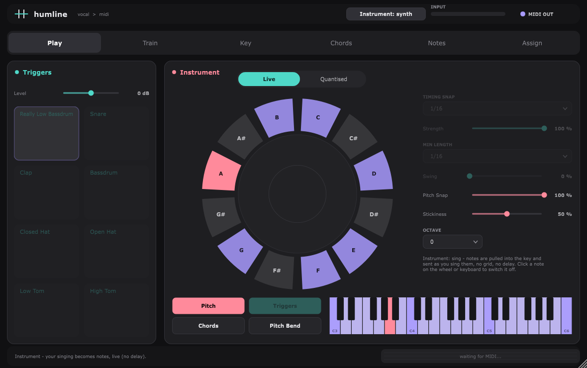
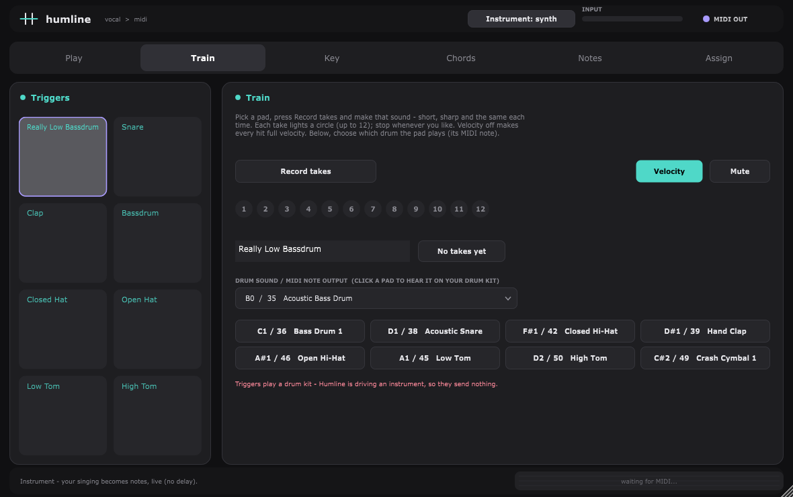
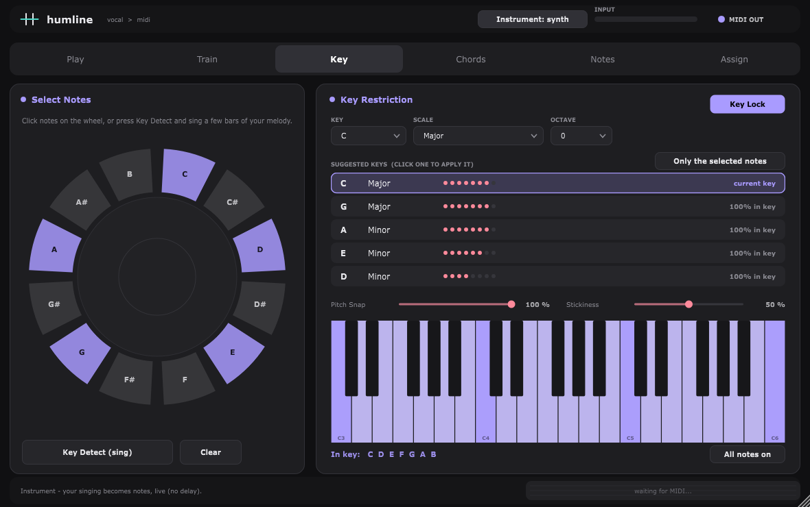
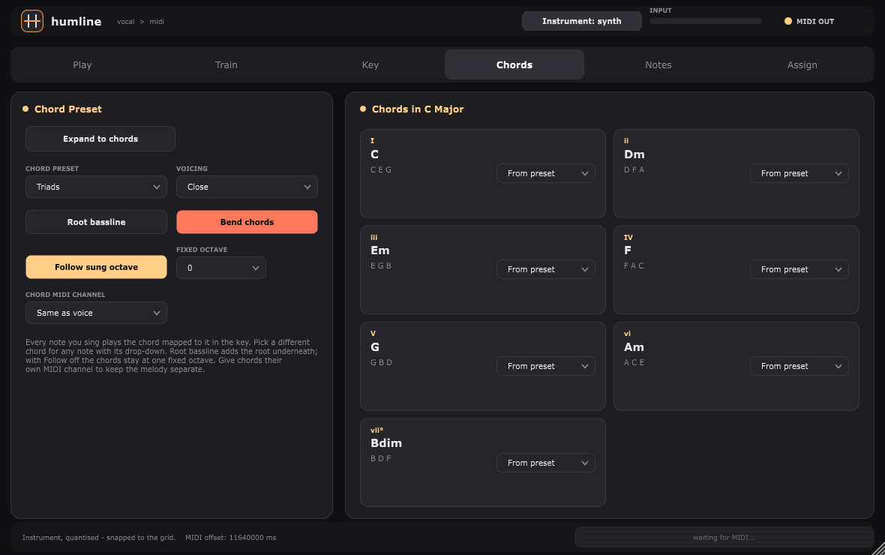
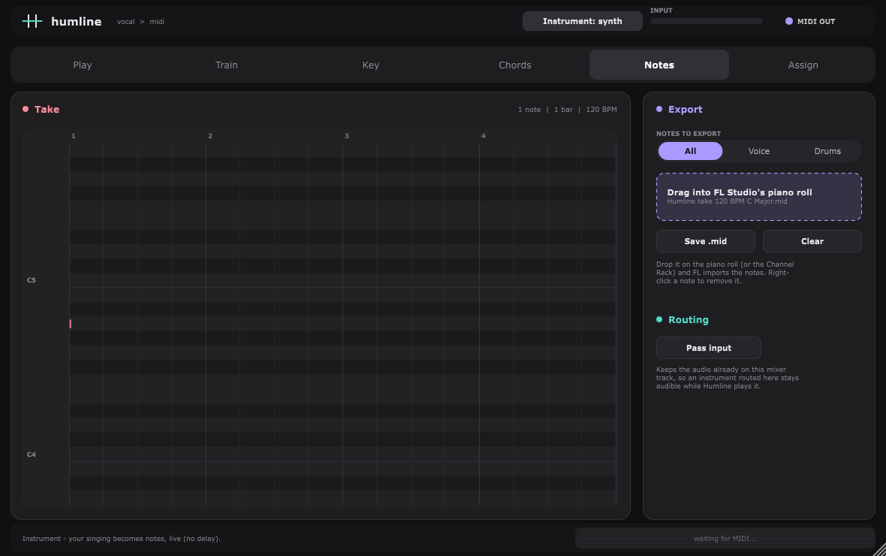
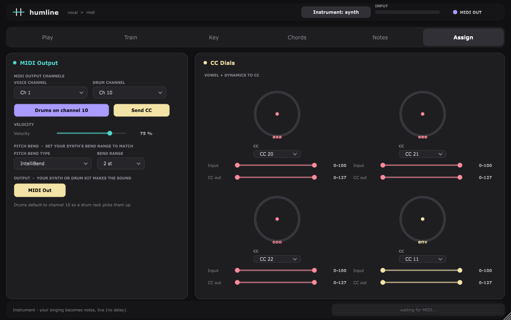
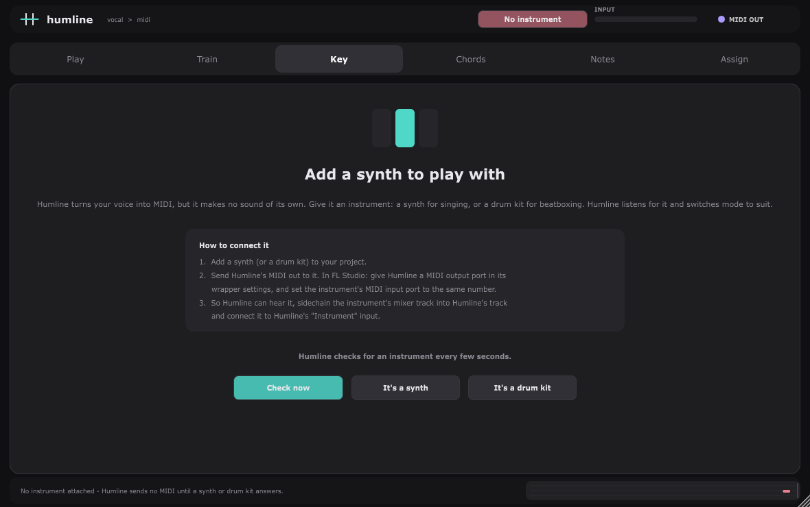

# Humline — vocal / beatbox → MIDI

A VST3 plugin (plus a standalone app) that listens to a microphone, and writes
quantised MIDI out of the track: sing a melody or a bass line and it becomes
notes on the grid, in the key you choose; beatbox and it becomes drums.

Built with JUCE. The analysis core is plain C++ with no JUCE dependency, so it
can be unit-tested from a console binary.



## Screenshots

| | |
|:---:|:---:|
|  |  |
| **Train**: record takes for each trigger and pick the drum note it plays | **Key**: notes picked on the wheel, with suggested keys |
|  |  |
| **Chords**: the chord mapped to each degree of the key | **Notes**: the last take, ready to drag out or save as `.mid` |
|  |  |
| **Assign**: MIDI channels, pitch bend and the vowel/dynamics CC dials | **No instrument**: shown until a synth or drum kit answers |

The screenshots are rendered by `HumlineSmoke` (see [Tests](#tests)). To
regenerate them, run it with `HUMLINE_SNAPSHOT_DIR` set to a folder and copy
the PNGs it writes (all but `key-empty.png`) into `docs/screenshots/`.

## What it does

**The attached instrument sets the mode**
- Humline makes no sound of its own. It drives an instrument through its MIDI
  out, and the mode follows what that instrument is:
  - **Instrument** (a synth, keys, a bass): singing becomes notes and chords.
    Drums are not listened for, so nothing waits on a drum-or-note decision. A
    note goes out about 40 ms after you start singing it, snapped into the key,
    and stops as soon as you stop singing.
  - **Drum kit**: every sound is a drum. A hit is classified about 10 ms after
    its peak, and its MIDI note goes out about 20 ms after the hit.
  - **Nothing attached**: Humline sends no MIDI, and a full-window screen asks
    you to add a synth and shows how to connect it.
- **How Humline knows**: a plugin cannot see which instrument receives its MIDI,
  so Humline listens. It plays three short test notes (C4 and C3 held, then
  note 42, the GM closed hat) on the voice channel and the drum channel, and
  listens for the answer on its **Instrument** sidechain input (or, failing
  that, on its main input). Two pitches an octave apart that keep sounding while
  held mean an instrument. A hi-hat on note 42, notes that don't come back as
  pitches, notes that only partly answer, or short one-shot hits mean a drum
  kit. Silence means nothing is attached. A check takes about 2 seconds.
- While the "add a synth" screen is up, Humline checks every 4 seconds, but only
  while the transport is stopped and the input is quiet, so no test notes land
  in a recording. A check started by hand is refused while the transport plays,
  for the same reason. Once something answers, it stops checking.
- The header chip shows the current target. Click it to check again or to pick
  **A synth / instrument** or **A drum kit** by hand, if a check gets it wrong.
  The target is saved with the project.
- If the answer came in on the main input, the footer warns that Humline may hear
  the instrument as your voice. Route the instrument to the Instrument input.
- **Live / Quantised** (Play page): Live sends every event the moment it is
  detected. Quantised snaps to the grid, which needs a constant output delay
  (about 0.25 s at 1/16), so it is for recording quantised clips rather than
  playing live. In Live, the grid controls (Timing Snap, Strength, Min Length,
  Swing) don't apply, and the Play page greys them out. Training a trigger
  always uses the slower, more accurate measurement.

**Pitch → notes**
- YIN pitch tracking on a decimated signal (55 Hz – 1 kHz, monophonic).
- Notes are anchored to detected attacks, so a note's position comes from when
  you actually started it, not from when the pitch tracker made up its mind.
- Out-of-tune singing is pulled into the selected key/scale with a variable
  "Pitch Snap" amount (100 % = hard tune, 0 % = leave it alone).
- "Stickiness" sets how long the tracker holds a note: low values follow every
  slide, high values wait for a clear pitch change before moving (100 % is the
  stickiest). Both controls are sliders on the Play page and the Key page.
- Note lengths follow what you sang, snapped to the grid and clamped to a
  minimum length.
- **Pitch**, **Triggers**, **Chords** and **Pitch Bend** switches on the Play
  page turn each part on or off. With Pitch off, beatboxing still makes drums.
  The Play page also has the octave control.

**Pitch bend**
- With Pitch Bend on, the voice bends the note that is sounding, and only moves
  to a new note once it goes further than the bend range (range 2: start on C,
  slide up, and the note changes at D). Set the range (1-24 semitones) on the
  Assign page to match your synth's bend range.
- **IntelliBend** switches the bend off while you hold a note steady, so it stays
  in tune. Stickiness sets how wide that steady zone is. **TruBend** follows
  every movement of the voice, including slightly sharp or flat singing.
- Bends are sent on the voice channel. When chords have their own channel,
  **Bend chords** (Chords page) decides whether the chord bends too.

**Timing → the grid**
- Snap to 1/4, 1/8, 1/8T, 1/16, 1/16T or 1/32, or off.
- Strength controls how hard you get pulled onto the line (0–100 %).
- Swing delays the off-beats.
- Minimum length stops staccato blips from becoming machine-gun notes.

**Beatbox → drums**
- Onset detection on a 4-band split (sub, 800 Hz, 2 kHz, 5 kHz+) with an
  adaptive noise floor.
- Rule-based classification into 8 pads (really-low kick, snare, clap, kick,
  closed hat, open hat, low tom, high tom), each with its own output note.
- **Train** page: press **Record takes** and make the sound. Each take lights a
  circle, up to 12 per trigger, and you can stop whenever you like. Every take is
  kept as its own example, not averaged, and matching is nearest-neighbour over
  all of them, so a sound you perform a few different ways still matches.
  **Clear all takes** empties the bank. Takes are saved with the project. While
  recording, every percussive hit counts as a take, even a sound the rules would
  not have recognised as a drum.
- **Velocity** per trigger: on, the velocity follows how loud the hit was; off,
  every hit is sent at full velocity (127).
- **Kits** (Train page, under the pads): **Save kit...** writes the pad map, the
  takes, the velocity flags and the chord overrides to a `.humlinekit` file, and
  **Load kit...** brings them into another project. The **Factory kit** menu has
  two ready-trained starting points (**GM starter**, **808 / trap**), for a
  project that should not begin with nothing trained. Loading replaces what is
  trained, so it asks first; nothing else in the project is touched.
- Each pad plays a General MIDI drum note. Pick it from the list, or use one of
  the quick-pick buttons on the Train page. Clicking a pad sends its note to
  the attached drum kit, so you hear the sound it picked.
- Drums go to channel 10 by default so a drum rack picks them up.

**Output (Assign page)**
- Humline sends MIDI only. The mic is never passed through to the output unless
  you switch on Pass Input (DAW only). **MIDI Out** switches the MIDI off
  entirely, test notes aside.

**Key detection (Key page)**
- Press **Key Detect** and sing a few bars. The raw, unsnapped pitch of every
  voiced frame goes into a pitch-class histogram, and the wheel lights up the
  notes it hears. When you stop (or after 30 s), the best match is applied as
  the key restriction.
- Or click notes on the wheel to pick them by hand.
- Up to five suggested keys (Krumhansl-Kessler major/minor profiles, weighted
  by how much of the melody falls inside the scale) are listed with a match
  rating. Click one to apply it as the full key. With **Only the selected
  notes** on, it is applied as a subset: just the notes chosen on the wheel.

**Key restriction: switching notes off**
- Click an in-key note on the Play page's wheel or keyboard, or on the Key
  page's keyboard, to switch it off. Sung notes then snap to the nearest note
  that is still on. Click it again to switch it back on. **All notes on** on the
  Key page resets this. If every note is switched off, the whole scale is used.

**Vocal → chords (Chords page)**
- Every sung note is replaced by the chord mapped to it in the current key, so
  the MIDI out is a chord track instead of a single line.
- The mapping is diatonic: in C major the seven degrees map to C, Dm, Em, F, G,
  Am, Bdim; change the key or scale on the Key page and the chords follow.
- Chord presets: triads, sevenths, sus and power (fifths).
- Voicings: close, wide (upper voices an octave up) and open (root, fifth, then
  the third an octave up).
- **Custom chords**: every chord tile has a drop-down. Pick a different chord for
  that note (major, minor, dim, aug, sus2, sus4, 7, maj7, m7, m7b5, power), or
  leave it on "From preset".
- **Root bassline** adds the root an octave under the chord.
- **Follow sung octave**: on, the chord is built on the octave you sang; off, it
  stays at one octave (root between C4 and B4), shifted by **Fixed octave**.
- **Chord MIDI channel**: "Same as voice" replaces the melody with the chord.
  Pick a channel and the melody stays on the voice channel while the chord goes
  out on its own channel.
- A held note keeps its whole chord held; every voice starts and stops on the
  same sample, so the chord is tight.
- The page shows the chord for each degree of the key, with its roman numeral
  and notes, and lights up the chord you are singing.

**Also**
- Vowel (aaa/eee/ooo) and dynamics (env) are streamed as CC, with assignable
  CC numbers. Each dial has an **Input** range, the part of the vowel/envelope
  reading that sweeps the whole dial (lower its max if you can't reach the top),
  and a **CC out** range, the span of CC values it covers (for example, to cap a
  filter cutoff). A reversed output range inverts the dial.
- Selectable MIDI channels for voice and drums.
- Everything is saved in the plugin state: parameters, pad notes and velocity
  switches, every trigger take, notes switched off, and custom chords.

## Download

Every push to `main` builds both platforms and publishes them as the
[**latest**](https://github.com/invot/humline/releases/tag/latest) release,
replacing the previous build (see
[`.github/workflows/release.yml`](.github/workflows/release.yml)):

- **Windows**: `Humline-Setup-Windows.exe` (installs the standalone app and the
  VST3) and `Humline-VST3-Windows.zip`.
- **macOS**: `Humline-VST3-macOS.zip`, `Humline-AU-macOS.zip` and
  `Humline-Standalone-macOS.zip`. The Audio Unit (`.component`) is macOS's
  native plugin format — the equivalent of VST3 there, and what every macOS
  host loads — so it is built alongside the VST3. Both bundles are universal
  (Apple Silicon and Intel) and ad-hoc signed.

The Windows build uses the same MinGW toolchain and patched JUCE 6.1.6 as
below; the macOS build uses the runner's Xcode compiler and JUCE 8.0.6. Nothing
is published unless the tests and the smoke test pass on both platforms.

## Building

Requires CMake 3.22+ and a C++20 compiler.

### MSVC (recommended, standard JUCE setup)

```bash
cmake -S . -B build -G "Visual Studio 17 2022" -DDBC_JUCE_DIR=<path to JUCE 6.1.6 or 7/8>
cmake --build build --config Release
```

### macOS

`AU` is added to the plugin's formats on Apple platforms only, so a macOS build
writes the Audio Unit next to the VST3:

```bash
cmake -S . -B build -DDBC_JUCE_DIR=<path to JUCE 8> \
      -DCMAKE_OSX_ARCHITECTURES="arm64;x86_64" \
      -DCMAKE_OSX_DEPLOYMENT_TARGET=11.0
cmake --build build -j 8
```

`build/Humline_artefacts/Release/` then holds `VST3/Humline.vst3`,
`AU/Humline.component` and `Standalone/Humline.app`. Copy the first two into
`~/Library/Audio/Plug-Ins/VST3/` and `~/Library/Audio/Plug-Ins/Components/`.

### MinGW-w64 (what this repo was built with)

JUCE 6.1.6 is the last version that officially supports MinGW; this project is
pinned to it and carries three small compatibility patches for modern GCC
(missing `<cstring>`/`<utility>` includes and MinGW's UIAutomation macros).
The includes are forced with `CMAKE_CXX_FLAGS` below; the UIAutomation fix is
[`ci/juce-6.1.6-mingw.patch`](ci/juce-6.1.6-mingw.patch), applied to the JUCE
tree with `git apply` from inside `JUCE-6.1.6`. The compiler is WinLibs GCC
16.2.0 (UCRT, posix-seh, r3):

```bash
cmake -S . -B build/plugin -G "MinGW Makefiles" -DCMAKE_BUILD_TYPE=Release \
      -DDBC_JUCE_DIR=<path to JUCE 6.1.6> \
      -DCMAKE_CXX_FLAGS="-include utility -include cstring -include cstdint -include cstdio"
cmake --build build/plugin -j 8
```

The VST3 bundle ends up in
`build/plugin/Humline_artefacts/Release/VST3/Humline.vst3`.
Copy it to `C:\Program Files\Common Files\VST3\` and rescan in your DAW.

The standalone app (`.../Standalone/Humline.exe`) works without a host. Use
the **Audio / MIDI settings** button in its header to choose the microphone,
the audio output and a MIDI output device. On Windows, a virtual MIDI port such
as loopMIDI lets a DAW record the standalone's MIDI. The label above the input
meter shows the device name (or "no mic"), so a closed input is visible. JUCE's
standalone wrapper mutes the mic by default to avoid feedback. Humline switches
that mute off, because it never sends the mic to the speakers.

## Tests

The analysis engine has a headless test suite (synthesised vocals and beatbox
hits, checking the emitted MIDI):

```bash
g++ -std=c++20 -O2 -I Source Tests/main.cpp Source/core/*.cpp -o build/tests.exe
./build/tests.exe
```

It covers grid snapping, swing, scale snapping in major/minor, late-and-sharp
singing being corrected, unsnapped singing keeping its timing, out-of-key notes
being pulled into the scale, kick/snare/hat classification, trigger training,
a sustained note producing exactly one MIDI note, the chord mapper
(diatonic triads/7ths, sus/power presets, voicings, and three sung notes
becoming three chords in the MIDI out), training on a sound the rules reject,
key detection (from histograms and from sung audio), the instrument check
(a saw synth, a slow pad, a pluck, a GM drum kit, a kick sample played
chromatically and silence, each heard on the Instrument input and on the main
input over mic noise, plus cancelling a check), and the features from the
Dubler 2 guides: notes switched off in the key, pitch on/off, a separate chord
channel, chord follow/octave/root bassline/custom chords, CC dial ranges,
per-trigger velocity, 12 stored takes per trigger, pitch bend (a C-to-D slide
bends one note with range 12, changes note with range 1; IntelliBend holds a
sharp note anchored while TruBend follows it).

`HumlineSmoke` (built with the plugin) runs the real processor and editor. It
checks that no notes go out with nothing attached, that notes do go out once an
instrument is attached and the audio output stays silent, that a pad click
sends its drum note on channel 10, that a full instrument check through the
processor (a fake synth on the Instrument input) finds an instrument, and that
the target, switched-off notes, custom chords, trigger velocity and takes
survive a save and load.

## Using it in a DAW

Humline is a VST3 that hosts load as an **audio effect**: it has a microphone
input, makes no sound of its own, and sends MIDI out. So every host needs the
same two moves - Humline on an audio track (a mixer track in FL) with the mic,
and its MIDI routed to an instrument on another track. Reaper is the exception:
MIDI passes along one FX chain, so a single track is enough.

1. Put Humline on an audio track and choose the microphone as that track's input.
2. Add the instrument you want to play - a synth, or a drum kit - and set that
   track's MIDI input to Humline. Keep monitoring (or arming) on to hear it.
3. So Humline can tell what it is driving, feed the instrument's audio into
   Humline's **Instrument** input. It then checks on its own; without that, pick
   **A synth / instrument** or **A drum kit** from the header chip.
4. Sing or beatbox. Notes and triggers go out on the channels you set (voice 1,
   drums 10 by default), and the instrument's track records them.

Humline's own track is silent by design. **Pass Input** is only for keeping the
audio already on a mixer track (an instrument routed to the same track, say); the
mic never reaches the output.

### Ableton Live

Live files Humline under audio effects, so it belongs on an **audio track**.
(Live will also accept an audio effect after an instrument on a MIDI track, but
Humline's output is silence, so the instrument behind it goes quiet unless
**Pass Input** is on.)

1. Create an audio track, drop Humline on it, and set **Audio From** to the
   microphone's input.
2. Create a MIDI track and load the synth (or a Drum Rack) on it.
3. On that MIDI track set **MIDI From** to Humline's track, and the chooser under
   it to **Humline** (**Post FX** if that is what your version lists).
4. Set **Monitor** to **In** (or arm the track) to hear it; arm the track and
   record to capture the notes.

Two Live specifics:

- **Live merges MIDI channels** when it routes between tracks, so everything
  Humline sends arrives on one channel. A Drum Rack does not mind (it maps notes,
  not channels), but a multitimbral instrument plays every part on one channel,
  and **Chord MIDI channel** cannot split anything downstream. Leave it on
  "Same as voice" and drive one instrument, or run two Humline instances with an
  instrument each.
- Live's plug-in MIDI routing depends on the version. If Humline's track does not
  show up in **MIDI From**, run the standalone app and record its virtual MIDI
  port instead (see the end of this section).

For the automatic check, point the sidechain input Live offers for the plug-in at
the instrument's track; if Live offers none, pick the target by hand.

### FL Studio

1. Put Humline on a mixer track and choose the microphone as that track's input.
2. In Humline's wrapper settings (the gear icon on its window), set a **MIDI
   output port** number.
3. On the instrument's channel, set the same number as its **MIDI input port**.
4. To let Humline hear the instrument, send the instrument's mixer track to
   Humline's (select Humline's track and click the send arrow on the instrument's
   track), or pick the target by hand.

To keep the notes, record on the instrument's channel, or drag the take from
Humline's **Notes** page onto the piano roll - FL imports `.mid`.

### Reaper

Reaper passes MIDI between plug-ins in the same FX chain, so one track is enough:

1. Insert Humline, then the instrument, in the same track's FX chain, in that
   order.
2. Set the track's record input to the microphone and enable **Record
   monitoring**.
3. Set the track to **Record: output -> Record: output (MIDI)** and record; the
   instrument plays the notes as they arrive.
4. For the automatic check, send the instrument's audio into Humline's extra
   input pair (the plug-in's I/O window), or pick the target by hand.

### Studio One

1. Put Humline on an audio track and choose the microphone as the track's input.
2. Load the instrument on a second, instrument track.
3. Expand the instrument track's header to show the MIDI routing, and set
   **Instrument Input** to Humline with **MIDI Output 1** as the channel.
4. Enable monitoring for the instrument track, arm it, and record.

If Studio One offers Humline a sidechain input (the plug-in's extra input), point
it at the instrument so the check can identify it; otherwise pick the target by
hand.

### If a host will not route a plug-in's MIDI

Run the standalone app, choose a virtual MIDI port as its output (loopMIDI on
Windows, for example), and record that port in the DAW. The **Audio / MIDI
settings** button in the standalone opens the device chooser, and the header
shows the port it is sending to.

### Timing note

In **Live** (the default) events go out as soon as they are detected
(about 20 ms for a drum hit, about 40 ms for a sung note), so you can play live
and the timing is your own.

In **Quantised** the plugin has to hear a note (and, for drums,
hear it decay) before it can quantise it, so every event is sent a constant
offset after its musical position: about 0.25 s at a 1/16 grid. Because the
offset is constant, a recorded clip is rhythmically exact and only needs to be
nudged left by that amount once. The footer shows the exact value.

## Layout

```
Source/
  core/          JUCE-free analysis engine
    PitchDetector    YIN pitch tracking
    OnsetDetector    band split + adaptive onset detection
    DrumClassifier   template matching + fallback rules
    Chords           diatonic chord mapping, voicings, chord names
    Quantizer        grid/scale/strength/swing maths
    VoiceEngine      streaming analysis → MIDI events (+ key histogram)
    KeyDetector      pitch-class histogram → ranked key suggestions
    InstrumentProbe  test notes → synth / drum kit / nothing
  PluginProcessor  JUCE processor, parameters, state, instrument checks
  PluginEditor     window, header, footer, monitor
  StandaloneBridge standalone-only: device dialog, input unmute, MIDI out
  ui/              look & feel, wheel, keyboard, pads, dials, panels
Tests/main.cpp   headless engine tests
Tests/smoke.cpp  processor + editor smoke test
```

## Not implemented

- Polyphonic pitch detection — singing two notes at once is not tracked.
- Chord *progressions*: the Chords page maps each sung note to a chord in the
  key; it does not generate its own harmony from a progression.
- Drums *and* melody from one Humline at once: the attached instrument picks
  one or the other. Use two Humline instances for both.
- Instrument detection is a heuristic. A pluck or 808 that dies away very fast
  can read as a drum kit, and a pitched one-shot sample as an instrument. Pick
  the target by hand from the header chip when that happens. Humline also does
  not notice when an instrument is removed later. Use **Check again**.
- With an instrument attached, any pitched sound becomes a note, so a beatboxed kick with a
  clear pitch can come out as a very low note.
- A separate MIDI-capture plugin (Dubler's "MIDI Capture"): Humline is itself
  the plugin on the track, so the DAW records its MIDI output directly. There is
  no in-plugin clip to drag out, and no "updated key" suggestion after a take.
- More than 8 triggers: the pads are a fixed set of 8.

## Licence

Copyright (C) 2026 invot.

Humline is released under the **GNU Affero General Public License v3.0 or later**
(AGPL-3.0-or-later) — see [LICENSE](LICENSE). This is the licence JUCE 8 itself is
distributed under for open-source use: JUCE is dual-licensed as AGPLv3 or a paid
JUCE licence, so building and shipping Humline under AGPLv3 costs nothing. To ship
closed-source binaries instead you need a JUCE licence (the free Starter tier
covers up to $20,000 annual revenue) and a different licence for this code.
